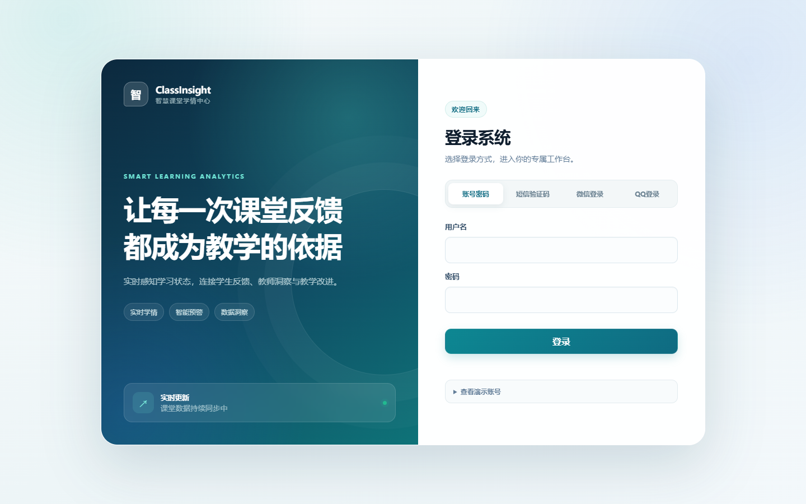
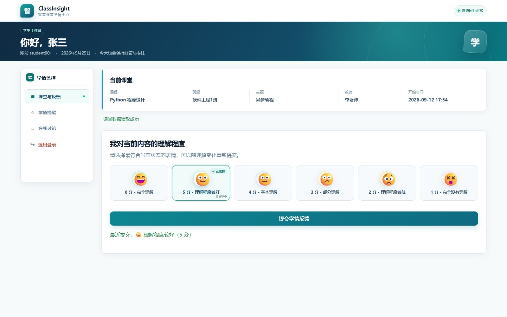
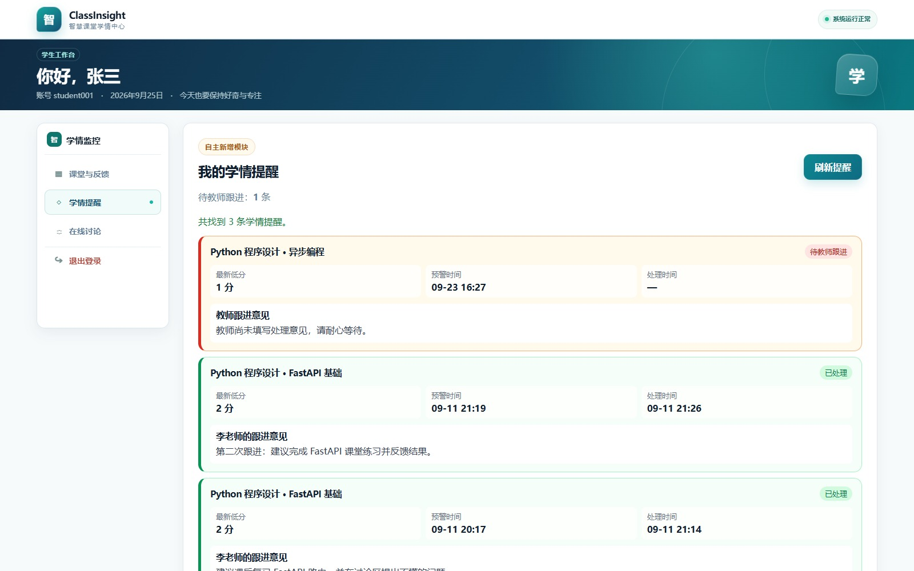
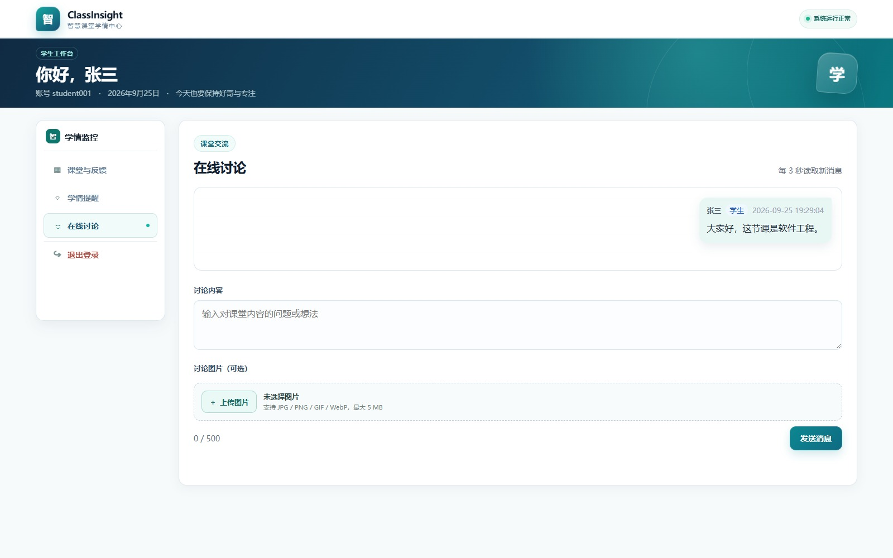
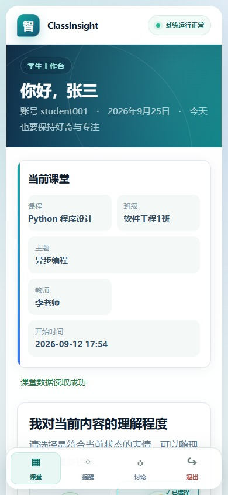
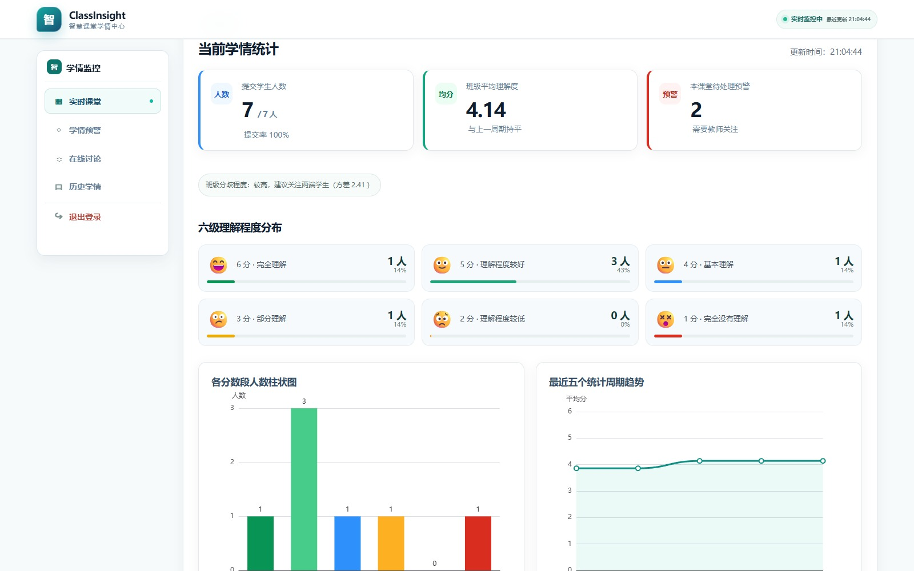
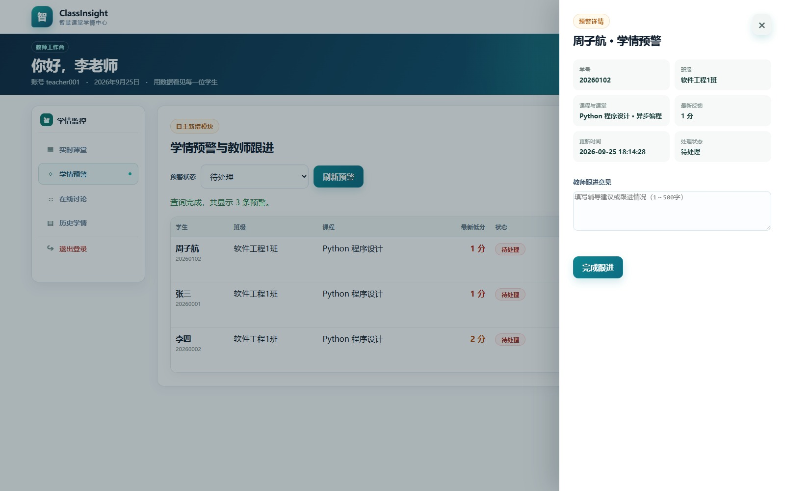
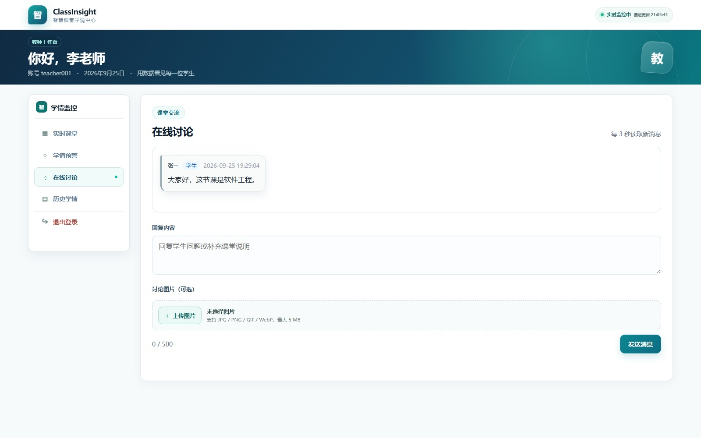
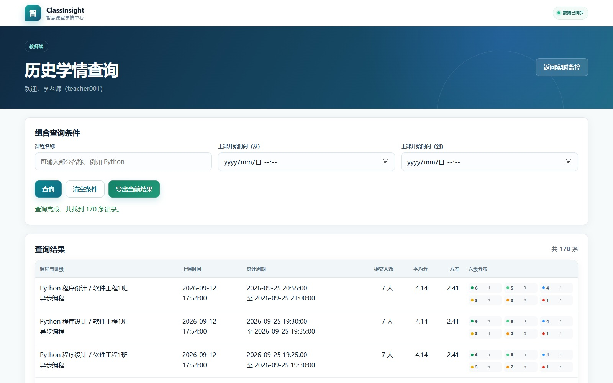

# 课堂学情监控管理系统用户使用手册

## 1. 系统入口与测试账号

启动系统后，在浏览器打开 <http://127.0.0.1:8000>。不要直接双击 HTML 文件，因为页面需要通过 FastAPI 读取数据库和接口。

测试账号统一密码为 `123456`。核心账号如下：

| 角色 | 账号 | 手机号 | 登录后页面 |
| --- | --- | --- | --- |
| 学生 | `student001` | `13800000001` | 学生端 |
| 教师 | `teacher001` | `13800000002` | 教师端 |
| 管理员 | `admin001` | `13800000003` | 管理员端 |

当前运行数据库还提供以下批量测试账号：

| 角色 | 账号 | 用途 |
| --- | --- | --- |
| 学生 | `student002`、`student101`～`student105` | 软件工程1班，可测试当前活动课堂 |
| 学生 | `student106`～`student107` | 人工智能1班，可测试对应活动课堂 |
| 学生 | `student108` | 数据科学1班，需先创建活动课堂 |
| 学生 | `student109` | 已停用，用于测试启用、停用与登录拦截 |
| 教师 | `teacher101`、`teacher102` | 新课程分配与教师权限测试 |
| 管理员 | `admin101` | 管理员权限测试 |

完整姓名、学号、班级、手机号和当前课程状态见《[当前演示数据说明](当前演示数据说明.md)》。

## 2. 多种登录方式

### 2.1 账号密码登录

1. 保持“账号密码”页签被选中。
2. 输入账号和密码。
3. 点击“登录”。
4. 系统根据角色进入学生端、教师端或管理员端。

### 2.2 短信验证码登录

1. 点击“短信验证码”页签。
2. 输入账号已登记的手机号，例如 `13800000001`。
3. 点击“获取验证码”。
4. 本地课程演示不会真正发送短信，页面会显示六位测试验证码。
5. 在五分钟内输入验证码并点击“短信登录”。验证码只能成功使用一次。

### 2.3 微信和 QQ 演示登录

登录页下方提供本地模拟授权按钮。微信演示进入 `student001` 学生端，QQ 演示进入 `teacher001` 教师端。真实开放平台凭据、回调域名和短信供应商没有在 PRD 中规定，属于需要自行设计的生产化内容，因此课程作业采用可离线演示方案。

## 3. 学生端操作

登录后的欢迎区会显示姓名、账号和当前日期。电脑浏览器宽度达到 1024 像素时，页面左侧会固定显示“学情监控”功能导航，当前模块使用浅色底、强调色边框和状态点标识；点击“课堂与反馈”“学情提醒”或“在线讨论”后，右侧只显示对应功能。平板使用顶部标签，手机使用固定底部导航，常用入口不会再因横向空间不足而被裁切。

### 3.1 查看当前课堂并提交学情反馈

学生登录后先确认课程、班级、课堂主题、教师和开始时间。手机端会把课堂信息压缩为两列卡片，主题和较长信息自动占满一行。选择最符合当前理解程度的表情，再点击“提交学情反馈”；已经保存的选项会显示“当前状态”标记，便于区分历史选择与本次操作。提交成功后右下角会出现轻量提示；每次提交都会保留历史，教师实时统计只采用每名学生最新一次反馈。

六档含义如下：

| 分数 | 含义 |
| ---: | --- |
| 6 | 完全理解 |
| 5 | 理解程度较好 |
| 4 | 基本理解 |
| 3 | 部分理解 |
| 2 | 理解程度较低 |
| 1 | 完全没有理解 |

### 3.2 查看学情提醒

提交 1 分或 2 分后，系统自动创建或更新待处理预警。教师完成跟进后，学生可在“我的学情提醒”查看处理状态、教师姓名、处理时间和跟进意见。提醒卡片采用紧凑布局，桌面端三项摘要同排、手机端两列换行；列表时间简化为“月-日 时:分”，便于一屏查看更多记录。学生只能查看本人的记录。

### 3.3 参与在线讨论

在“在线讨论”区域输入最多 500 字的课堂问题或想法并发送。点击统一样式的“上传图片”可选择不超过 5 MB 的 JPG、PNG、GIF 或 WebP 图片；选中后组件显示文件名和“移除”按钮。学生自己的消息位于右侧并使用浅青色，教师或其他成员消息位于左侧并保留角色标签。页面每 3 秒自动读取一次新消息，无需刷新整个页面。当前没有消息时显示引导空状态；读取到第一条消息后空状态会完全隐藏，只保留真实消息列表。

### 3.4 手机浏览器使用

学生端支持手机和 PC 浏览器。手机页面底部为固定导航，正文额外预留底部安全区；实际滚动到页面最底部时，最后一张卡片和发送按钮不会被底栏覆盖。在同一局域网的手机访问时，需要把 `127.0.0.1` 换成电脑的局域网 IP，并把启动命令中的 `--host 127.0.0.1` 改为 `--host 0.0.0.0`；Windows 防火墙是否允许访问属于本机环境设置。

## 4. 教师端操作

电脑端左侧功能导航可在“实时课堂”“学情预警”和“在线讨论”之间切换；“历史学情”保留为独立查询页面。实时课堂作为数据驾驶舱，直接进入课堂信息与统计看板，不显示欢迎 Banner；学情预警和在线讨论属于业务处理页，保留紧凑的“你好，李老师”教师工作台 Banner。切换功能时，暂时隐藏的实时统计和讨论区会暂停无效轮询，返回对应功能后自动继续更新。

### 4.1 查看实时学情

教师登录后可查看本人当前授课课堂。统计区域每 5 秒读取最新结果，关键指标卡显示“已提交人数 / 班级启用学生数”、提交率、平均理解度和本课堂待处理预警；平均理解度会根据最近完整周期显示“与上一周期持平”或真实正负变化值。总体方差同时按实际数值转换成“较低、适中、较高”的班级分歧说明。下方显示六档人数、ECharts 柱状图和最近五个已完成统计周期的平均理解度趋势线。六档分布卡片同时显示人数、占比和短进度条，便于快速定位理解较低的分数段。右上角“实时监控中”会显示最近更新时间。

管理员设置的 5～10 分钟是“历史快照统计周期”：后台定时检查已经结束的周期并保存一次快照。它不会每隔几秒重复保存同一时间段，也不会停止后续周期；只要课堂为进行中，之后每个完整周期都会继续统计。

### 4.2 处理学情预警

在“学情预警与教师跟进”中选择全部、待处理或已处理。教师只能看到本人课程的记录。列表只保留学生、班级、课程、最新低分、状态、更新时间和操作；点击“查看并跟进”会从右侧打开详情抽屉，在其中填写 1～500 字意见并完成处理。空意见不会提交，输入框下方会显示明确提示并自动获得焦点。抽屉支持 `Tab` 键循环浏览、`Esc` 关闭，关闭后焦点返回原“查看并跟进”按钮。系统保存处理教师与时间，已经处理的记录只能查看详情，不能重复覆盖。列表时间统一显示为“月-日 时:分”，例如 `09-25 18:14`；完整时间仍保留在详情和后端数据中。

### 4.3 回复课堂讨论

教师讨论区与学生端共享同一课堂消息。教师可通过同一上传组件回复文字或图片，3 秒轮询会让双方看到新消息。教师看到学生消息时为左侧灰白气泡；教师自己发出的消息位于右侧浅青气泡，学生端看到教师回复时仍在左侧并显示绿色“教师”标签。存在消息时不会再显示“暂无课堂讨论”。管理员不能参与课堂讨论。

### 4.4 查询历史与导出 Excel

点击“查询历史学情”，可按课程名称、上课开始时间从/到进行单项或组合查询。六级人数使用带颜色语义的紧凑分布条展示，悬停可查看完整含义，减少横向文字堆叠。点击“导出当前结果”会下载与当前条件一致的 `.xlsx` 文件；空结果不会伪造数据。

## 5. 管理员端操作

电脑端左侧功能导航将管理功能分为“课程与课堂”“用户管理”和“统计周期”，右侧一次只展示当前模块；手机端改用固定底部导航，并显示“课程 / 用户 / 设置 / 退出”短标签。

### 5.1 课程与课堂管理

在管理员端左侧选择“课程与课堂”：

1. 在“新增课程”中选择已启用的教师，填写课程名称和可选说明，然后保存课程。
2. 在“创建课堂场次”中选择课程，填写班级、课堂主题和计划时间。
3. 选择“待开始”可先保存安排，之后在“最近课堂”列表点击“开始上课”；选择“立即上课”会直接创建活动课堂。
4. 授课结束后点击“结束课堂”。结束后的课堂会保留反馈、讨论、快照和预警历史。

为避免学生端或教师端选错课堂，系统禁止同一教师同时进行两个课堂，也禁止同一班级同时进入两个课堂。`seed.sql` 的可重复恢复基线提供一门示例课程和一个活动课堂；当前运行数据库已有 3 门课程、3 节课堂。这些都只是演示数据数量，不是系统容量限制。

### 5.2 用户管理

管理员可以按关键词和角色查询账号，并添加、编辑、启停或删除学生、教师、管理员。学生需填写学号、姓名、年龄、性别、年级、班级、专业和联系方式；教师、管理员填写姓名、年龄、性别和联系方式。登录账号、学号、手机号不能重复。角色与启停状态使用不同颜色的圆角标签；长表格滚动时表头和右侧操作列保持可见。每行直接保留“修改”主操作，“启用/停用”和“删除”收纳在“更多”菜单中，减少按钮拥挤；菜单项包含目标用户的辅助功能名称，支持点击页面空白处或按 `Esc` 关闭。启停和永久删除在真正执行前都会再次确认。

为避免破坏数据，系统禁止管理员删除自己，也会阻止删除仍被课程、反馈、消息、预警等数据引用的账号。需要保留历史但禁止登录时，优先使用“停用”。

### 5.3 统计周期配置

管理员可把统计周期设置为 5～10 分钟。修改后，新周期按最新配置继续生成；已经保存的历史快照保留各自的原周期值。页面同时展示已生成快照数、最近生成时间、进行中课堂数、任务运行状态、近 7 天真实快照趋势，以及当前周期的最近更新时间和操作人员；没有数据的日期显示为 0，不使用模拟数据补齐。

## 6. 退出与权限说明

每个角色的功能导航中都有“退出登录”。退出后原会话立即失效。直接访问其他角色页面或接口会返回无权限提示；学生只访问本人班级数据，教师只访问本人课程数据，所有业务功能都必须先登录。

## 7. 建议答辩演示顺序

1. 用学生账号提交一次 2 分，展示自动预警。
2. 用教师账号查看实时图表和待处理预警，填写跟进意见。
3. 回到学生端查看教师意见。
4. 学生与教师各发送一条讨论消息，可演示一张图片。
5. 教师查询历史并导出 Excel。
6. 管理员新增一门课程、创建待开始课堂，并演示开始/结束课堂。
7. 管理员展示用户条件查询和 5～10 分钟周期配置。

答辩后如不希望保留演示产生的数据，可先备份 `database/classroom_monitor.db`，再恢复备份；不要在不理解关联关系时手工删除数据库行。
