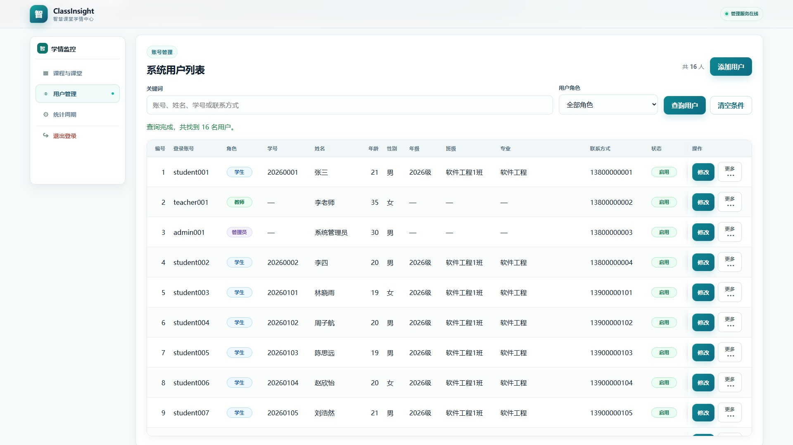
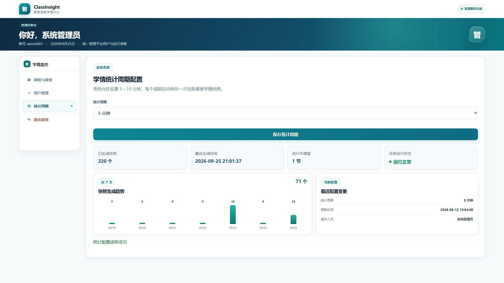

# 管理员功能验收记录

## 一、验收结论

- 验收日期：2026-09-12
- 环境：Windows、本地独立 Uvicorn 服务、SQLite 正式演示数据库
- 自动化结果：**75 项通过，0 项失败**
- 原验收数据保护：所有 `temp_admin_` 一次性用户已清理；当轮验收结束时 4 个基线账号和 6 分钟配置保持不变
- 2026-09-12 同步状态：当前运行数据库已按测试需要扩充为 16 个账号、3 门课程、3 节课堂，统计周期现为 5 分钟；详情见《[当前演示数据说明](当前演示数据说明.md)》

## 二、用户增删改查

验收覆盖学生、教师、管理员三类账号：

- 新增三种角色并核对数据库字段。
- 查询全部、按角色查询、按账号/姓名/学号/联系方式关键词查询。
- 修改姓名、年龄、性别、年级、班级、专业、联系方式和状态。
- 登录账号、学号、手机号重复时拒绝保存。
- 学生缺少学号、年级、班级或专业时拒绝保存。
- 教师和管理员不要求学生专属字段。
- 停用账号后既不能重新登录，原有会话也失效；重新启用后可以登录。
- 管理员不能停用或删除自己。
- 被课程、反馈、讨论、统计设置、预警等业务数据引用的用户不能直接删除。
- 无业务引用的一次性账号可删除，删除后查询返回不存在。

## 三、课程与课堂管理

后续优化新增了管理员课程与课堂管理界面及接口，验收结果如下：

- 管理员可以选择已启用教师新增课程；同一教师的同名课程返回 409，不重复写入。
- 管理员可以创建“待开始”或“立即上课”的课堂，填写课程、班级、主题和计划时间。
- 待开始课堂可以切换为进行中，进行中课堂可以结束；非法状态跳转返回 409。
- 系统阻止同一教师或同一班级同时进入两个活动课堂，避免学生端和教师端选错当前课堂。
- 5 个课程课堂管理操作的匿名请求 5/5 返回 401，学生请求 5/5 返回 403。
- 接口实测覆盖课程创建、课堂创建、开始、结束、重复课程和活动课堂冲突；成功请求返回 200/201，冲突返回 409。

当前运行数据库已用该功能创建“Web前端开发”和“机器学习与数据挖掘”等课程，证明系统并非只能保存一门课程。

## 四、统计周期配置

- 管理员读取当前周期成功。
- 5 分钟和 10 分钟边界均可保存。
- 4 分钟和 11 分钟被 Pydantic/数据库约束拒绝。
- 学生、教师和匿名用户不能修改配置。
- 测试结束后恢复正式配置为 6 分钟。

## 五、权限与输入安全

用户管理、课程课堂管理和统计配置接口只允许管理员。学生、教师访问返回 403，匿名访问返回 401。密码只保存 PBKDF2-SHA256 散列，查询列表和接口响应不返回 `password_hash`。删除和状态修改会检查当前管理员以及业务关联，避免破坏数据库历史。

## 六、桌面工作台补充验收

管理员页面现采用“课程与课堂 / 用户管理 / 统计周期”功能切换。宽度不小于 1024px 时显示固定左侧导航，右侧一次只显示一个模块；手机端改为固定底部导航。管理员登录、页面、工作台脚本和样式资源均已通过 HTTP 200 冒烟检查。

## 七、2026-09-25 界面一致性补充验收

- 用户表每行保留“修改”主按钮，把启停与删除收纳进“更多”浮层；浮层已在真实浏览器中检查，不受表格滚动容器和固定表头裁切，点击空白或按 `Esc` 可关闭。
- “更多”菜单中的启停和删除项包含“操作 + 用户姓名”的辅助功能名称；启停和永久删除仍在执行前显示二次确认，避免误操作。
- 统计周期页增加已生成快照、最近生成时间、进行中课堂、任务状态、近 7 天快照趋势和最近配置摘要；所有数量、日期和操作人均由现有数据库查询得到，零数据日期显示为 0。
- 390×844 视口下管理员导航固定在底部，使用“课程 / 用户 / 设置 / 退出”短标签，并保留设备底部安全间距。
- 使用运行数据库临时副本重新生成 `09_管理员用户管理.jpg` 与 `10_管理员统计周期.jpg`，正式演示数据库未被修改。

## 八、结论

PRD 中管理员对学生、教师、管理员的条件查询、增加、修改、删除、启停以及完整字段要求均已覆盖；后续增加的课程与课堂管理和桌面工作台也已完成接口与资源加载复测。原管理员自动化验收 75/75 继续作为基础功能证据。
